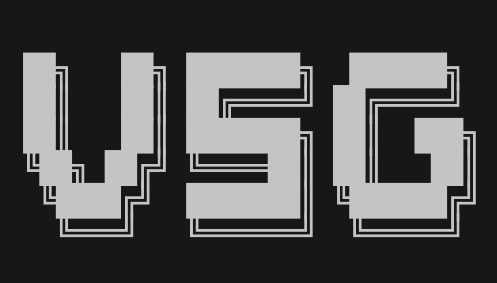

  

<h1 align="center">Hey, I'm Vaishnav 👋</h1>

  <em>Electronics engineer · Embedded systems · Linux · Open source</em>

  
  

---

⚡ I'm an electronics engineering graduate passionate about **embedded systems** and **Linux**.

🔧 I work with microcontrollers and Linux, and contribute to open-source projects.

🌱 Currently learning Japanese (目指せN1!).

 

### 🌟 Featured Projects

| Project | What it is |
|--|--|
| [**miru**](https://codeberg.org/Vaishnav-Sabari-Girish/miru) | A Wayland-native zooming daemon |
| [**ComChan**](https://github.com/Vaishnav-Sabari-Girish/ComChan) | Blazingly fast serial monitor with a plotter, BLE log viewer and more |
| [**Zephyr-Experiment**](https://codeberg.org/Vaishnav-Sabari-Girish/Zephyr-Experiment) | Hands-on experiments with Zephyr RTOS fundamentals, drivers and embedded workflows |
| [**Embedded Rust**](https://github.com/Vaishnav-Sabari-Girish/Embedded-Rust) | Embedded Rust programs for multiple microcontrollers |
| [**Daily-Kanji**](https://codeberg.org/Vaishnav-Sabari-Girish/Daily-Kanji) | Kanji practice TUI with a PDF report generator |
| [**dotfiles**](https://codeberg.org/Vaishnav-Sabari-Girish/dotfiles) | The dotfiles for my Linux system |

 

### 🛠️ What I'm up to

| | |
|--|--|
| **Building** | Open-source Rust libraries and embedded applications |
| **Developing** | Embedded tools that make people's lives easier |
| **Contributing** | Open-source embedded development tools and libraries |
| **Exploring** | Modern embedded development workflows and automation |
| **Learning** | Japanese and advanced embedded systems concepts |
| **Graduated** | B.Tech in Electronics and Communication Engineering, Jain University |

 

### 💻 Technologies

**Languages:** Rust • C/C++ • Python • Bash • JavaScript • Typst • HTML/CSS 
**Hardware:** STM32 • ESP32 • RP2040 • Nordic • NXP 
**Tools:** Git • Linux • Neovim • KiCad 
**Learning:** Japanese 🇯🇵

 

### 🌐 Connect

  
  
  
   
  
  
  
  

<b>~</b> <em><a href="https://vaishnavs.is-a.dev">vaishnavs.is-a.dev</a></em>

